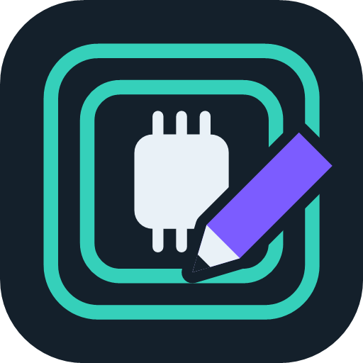

<h1 align="center">Gaming library</h1>

  <a href="README.md">Español</a> · <b>English</b>  
  <a href="https://cafecito.app/matcarfer">☕ Cafecito</a> · <a href="https://ko-fi.com/matcarfer">☕ Ko-fi</a> · <a href="https://www.patreon.com/matcarfer">❤ Patreon</a>

## 📱 Android

<table>
<tr><th width="30%">Name</th><th width="70%">Description</th></tr>
<tr><td colspan="2"><b>Free Android apps for games</b></td></tr>
<tr><td>&nbsp; <b><a href="https://github.com/matcarfer/LDStudio">LD Studio</a></b></td><td>Read and write NTAG213, 215 and 216 NFC tags compatible with LEGO Dimensions. Unofficial.</td></tr>
</table>

## 🎮 Trainers

<table>
<tr><th width="30%">Name</th><th width="70%">Description</th></tr>
<tr><td colspan="2"><b>Free PC game trainers</b></td></tr>
<tr><td>&nbsp; <b><a href="https://github.com/matcarfer/vampire-survivors-trainer">Vampire Survivors</a></b></td><td>11 cheats with keyboard shortcuts. Offline only. For the Steam version (64-bit).</td></tr>
<tr><td>&nbsp; <b><a href="https://github.com/matcarfer/warhammer-survivors-trainer">Warhammer Survivors</a></b></td><td>11 cheats with keyboard shortcuts. For the GOG version (64-bit).</td></tr>
</table>

---

Each app has its own license, stated in its repository and inside the app. <a href="LICENSE.en">License</a>. 
Everything is provided as is, without warranty; use at your own risk. Donations are voluntary and do not apply to LD Studio, which neither requests nor accepts contributions or donations.

