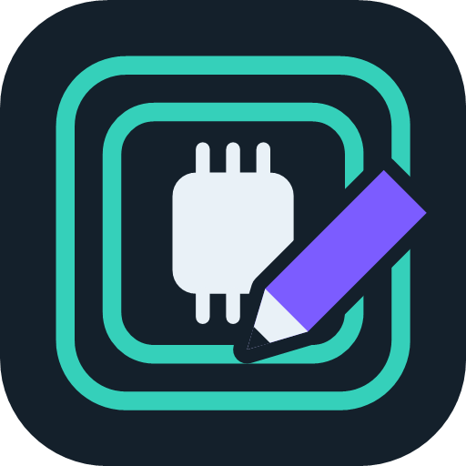

<h1 align="center">Biblioteca gaming</h1>

  <b>Español</b> · <a href="README.en.md">English</a>  
  <a href="https://cafecito.app/matcarfer">☕ Cafecito</a> · <a href="https://ko-fi.com/matcarfer">☕ Ko-fi</a> · <a href="https://www.patreon.com/matcarfer">❤ Patreon</a>

## 📱 Android

<table>
<tr><th width="30%">Nombre</th><th width="70%">Descripción</th></tr>
<tr><td colspan="2"><b>Apps Android para juegos gratis</b></td></tr>
<tr><td>&nbsp; <b><a href="https://github.com/matcarfer/LDStudio">LD Studio</a></b></td><td>Leé y escribí tags NFC NTAG213, 215 y 216 compatibles con LEGO Dimensions. No oficial.</td></tr>
</table>

## 🎮 Trainers

<table>
<tr><th width="30%">Nombre</th><th width="70%">Descripción</th></tr>
<tr><td colspan="2"><b>Trainers para juegos de PC gratis</b></td></tr>
<tr><td>&nbsp; <b><a href="https://github.com/matcarfer/vampire-survivors-trainer">Vampire Survivors</a></b></td><td>11 trucos con atajos de teclado. Solo offline. Para la versión de Steam (64 bits).</td></tr>
<tr><td>&nbsp; <b><a href="https://github.com/matcarfer/warhammer-survivors-trainer">Warhammer Survivors</a></b></td><td>11 trucos con atajos de teclado. Para la versión de GOG (64 bits).</td></tr>
</table>

---

Cada app tiene su propia licencia, especificada en su repositorio y dentro de la app. <a href="LICENSE">Licencia</a>. 
Todo se ofrece tal cual, sin garantía; usalo bajo tu responsabilidad. Las donaciones son voluntarias y no corresponden a LD Studio, que no pide ni acepta colaboraciones ni donaciones.

